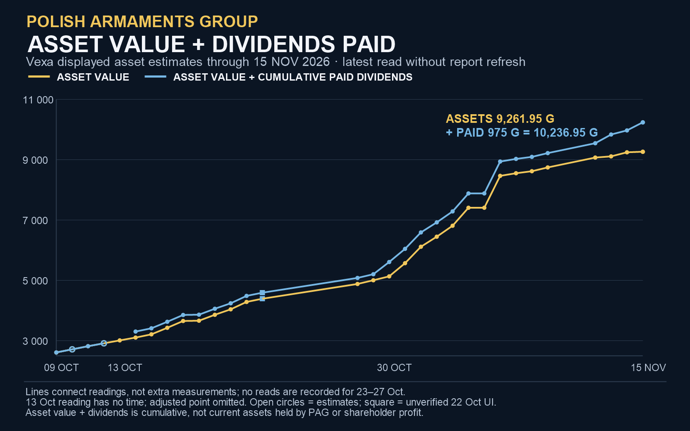

# PAG — Polish Armaments Group (Vexa)

[Interaktywny wykres](pag-growth.html) · [Eksport HTML](pag-chart.html) · [Historia danych](history.json) · [Spółka w Vexa](https://vexa.e-sim.org/stockCompany.html?id=45)

Ostatni odczyt widocznej strony Vexa: **15 listopada 2026, 21:17 czasu polskiego** — wyświetlana szacowana wartość **9 306,26 Gold**, **2 800 akcji**, **11 udziałowców** i **24 firmy**. Leandro Daniels ma **2 422 akcje (86,50%)**. Wyświetlana wartość aktywów na akcję: **3,32 Gold**. Odczyt wykonano bez odświeżania raportu.

Względem poprzedniego odczytu z 15 listopada o 19:58: wartość wzrosła o **44,31 Gold (+0,48%)**; liczba akcji, udział Leandro, udziałowcy i liczba firm pozostały bez zmian. Względem 14 listopada wartość jest wyższa o **59,30 Gold (+0,64%)**, przyrost odnotowano o 22 akcje ogółem i 2 akcje Leandro oraz 3 firmy.

Historia zachowuje **33 pomiary** do 15 listopada, w tym trzy odczyty tego dnia. Logi Vexa potwierdzają **975 Gold w siedmiu wypłatach**: 200 Gold (13 października), 275 Gold w czterech przelewach (30 października) i 500 Gold w dwóch przelewach (13–14 listopada). Kolejne rundy wypłat wzrosły o **37,50%** oraz **81,82%**. Odstępy wyniosły około 17 dni, a potem 14–15 dni; statut określa plan dwutygodniowy, nie gwarantowaną regularność.

The chart now shows **TOTAL DIVIDENDS PAID: 975 GOLD**, **DIVIDENDS PER CURRENTLY ISSUED SHARE: 0.3482 GOLD / SHARE**, and **CUMULATIVE RETURN ON 5 GOLD ISSUE PRICE: 6.96%**. The calculation is 0.3482 Gold in recorded dividends per currently issued share ÷ 5 Gold issue price. It is a distribution metric for a share bought at the original 5 Gold issue price, not a market price, future yield or individual shareholder return.

Najnowsze **9 306,26 Gold wartości aktywów + 975 Gold wcześniej wypłaconych dywidend = 10 281,26 Gold** to miara skumulowana do porównania. Nie oznacza aktywów pozostających w spółce, zysku PAG ani stopy zwrotu akcjonariusza. Wycena aktywów obejmuje zmiany kapitału i cen.

## Źródła i statusy

- Odczyty Vexa pochodzą z widocznej strony spółki; czas pomiaru jest zapisany w polu observed_at. Raportu nie odświeżano, a wyświetlana wartość pozostaje szacunkiem Vexa.
- Wiersz imienny Leandro Daniels jest źródłem jego liczby akcji; pole factories przechowuje liczbę firm widoczną na stronie spółki.
- Szacunki brakujących dni 10 i 12 października są oznaczone jako estimated_missing_day; nie są pomiarami.
- Zapis UI z 22 października ma status saved_ui_refresh_unverified; odświeżenie wyceny nie zostało niezależnie potwierdzone.
- Dane z 9–22 października pochodzą z raportu graficznego przekazanego przez użytkownika. Oznaczenia zachowują wskazane źródło, nie stanowią niezależnej weryfikacji.
- Brak pomiarów z 23–27 października. Linie na wykresie łączą zapisane obserwacje i nie dodają pomiarów.
- Dywidendy są odrębnymi zapisami z logów i nie są dodawane do historycznej wyceny aktywów. Wykres skorygowany pomija 13 października, bo ten odczyt nie ma godziny; odczyt 14 listopada poprzedzał wypłatę o 23:53:58.

## Aktualizacja

history.json jest źródłem danych. Zachowuj wcześniejsze wpisy i dopisuj odczyty z czasem, źródłem i statusem; wartości nieznane zapisuj jako null. Standardowy generator python build.py wymaga Pythona 3 i Pillow. Po zmianie sprawdź historię, wygenerowane PNG i pliki HTML przed publikacją. Nie zapisuj lokalnych notatek w repozytorium.
