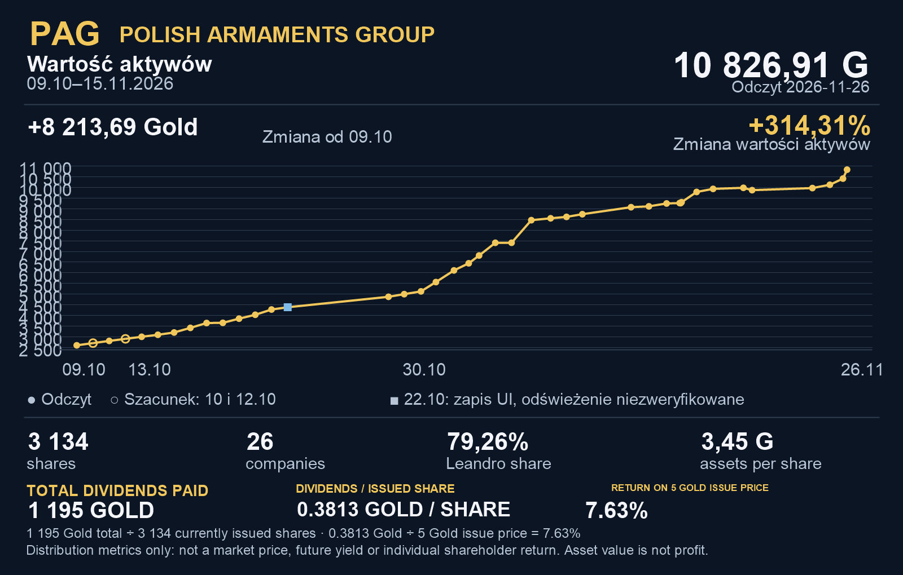
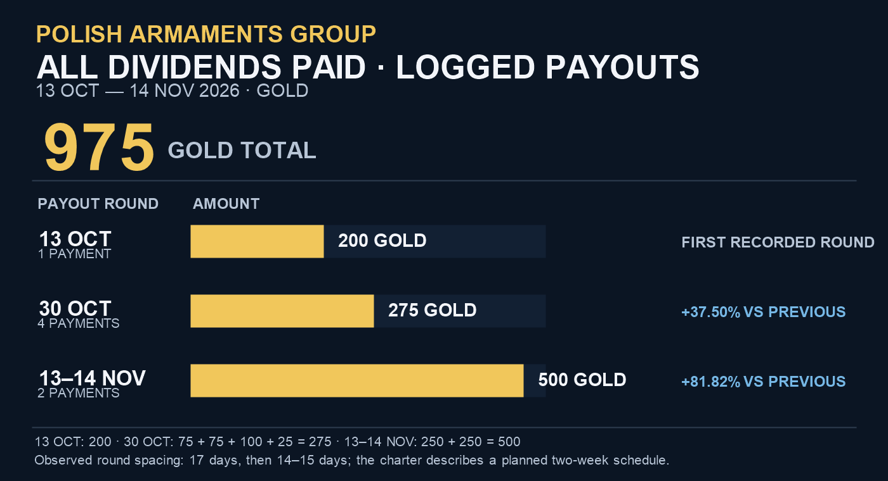

# PAG — Polish Armaments Group (Vexa)

[Wersja interaktywna — pobierz plik i otwórz w przeglądarce](pag-chart.html) · [Historia pomiarów](history.json) · [Spółka w Vexa](https://vexa.e-sim.org/stockCompany.html?id=45)

Ostatni odczyt widocznej strony Vexa: **15 listopada 2026, 18:33 czasu polskiego** — **9266,12 Gold**, 2800 akcji, 11 udziałowców i 24 firmy. Leandro Daniels: 2422 akcje (86,50%). Wyświetlana wartość aktywów na akcję: **3,31 Gold**. Względem 14 listopada: +19,16 Gold (+0,21%), +22 akcje ogółem, +2 akcje Leandro i +3 firmy. Odczyt bez odświeżania raportu; wartość pozostaje szacunkiem Vexa.

Historia zawiera 31 zapisów do 15 listopada. Logi Vexa zawierają **975 Gold w siedmiu wypłatach**: 200 Gold (13 października), 275 Gold w czterech przelewach (30 października) i 500 Gold w dwóch przelewach (13–14 listopada). Kolejne rundy wzrosły o **37,50%** i **81,82%**. Odstępy między rundami w logach wyniosły około 17 dni, następnie 14–15 dni; statut opisuje dwutygodniowy plan, nie gwarancję. Wykres „wartość aktywów + wypłacone dywidendy” jest miarą skumulowaną, nie aktywami pozostającymi w spółce ani zyskiem akcjonariusza.
## Źródła i statusy

- 9–22 października: [oryginalny raport graficzny](https://github.com/piotrzdrenka-droid/pag-chart/blob/dabc5284a8e3a2c2b851749b9b2a80d6f93eb245/pag-chart.png), przekazany przez użytkownika 29 października. Oznaczenie „potwierdzone według raportu” zachowuje deklarację źródła; nie oznacza niezależnej weryfikacji.
- 10 i 12 października: szacunki brakujących dni z oryginalnego raportu, oznaczone pustymi kółkami. Nie są pomiarami.
- 22 października: zapis UI (4393,91 Gold; 1888 akcji; 9 udziałowców; 16 firm; 2,33 Gold na akcję według raportu), oznaczony kwadratem. Odświeżenie wyceny niezweryfikowane.
- 11 października: dane użytkownika z wcześniejszej rozmowy, zgodne z raportem.
- 28 października: wcześniejszy odczyt publicznej strony Vexa. Czas zapisu nie jest czasem aktualizacji wyceny aktywów.
- 29 października: odczyt publicznej strony Vexa; serwis potwierdził odświeżenie raportu.
- 30 października, 20:01 Europe/Warsaw: odczyt widocznej strony Vexa, bez wywołania odświeżenia raportu.
- 1 listopada, 20:48 Europe/Warsaw: odczyt publicznego HTML Vexa bez logowania przez HTTP GET; bez wywołania odświeżenia raportu.
- 2 listopada, 18:35 Europe/Warsaw: odczyt publicznego HTML Vexa bez logowania przez HTTP GET; bez wywołania odświeżenia raportu.
- 3 listopada, 09:56 Europe/Warsaw: odczyt publicznego HTML Vexa bez logowania przez HTTP GET; bez wywołania odświeżenia raportu.
- 3 listopada, 16:25 Europe/Warsaw: odczyt publicznego HTML Vexa bez logowania przez HTTP GET; bez wywołania odświeżenia raportu.
- 3 listopada, 21:29 Europe/Warsaw: odczyt publicznego HTML Vexa bez logowania przez HTTP GET; bez wywołania odświeżenia raportu.
- 3 listopada, 15:11 Europe/Warsaw: odczyt publicznego HTML Vexa bez logowania przez HTTP GET; bez wywołania odświeżenia raportu.
- Korekta odczytu 6 listopada: wiersz imienny Leandro Daniels wskazuje 2300 z 2640 akcji (87,12%); strona podaje 21 firm.\r\n- Dywidenda 200 Gold z 13 października według raportu jest osobnym zdarzeniem, nie została doliczona do wyceny.

Brakujące metryki są zapisane jako `null`. Nie interpolujemy brakujących dni jako pomiarów. Nie ma odczytów z 23–27 października.

## Aktualizacja i odtwarzanie

Źródłem danych jest `history.json`; dopisuj pomiary z datą, czasem odczytu, źródłem i statusem, nie usuwając wcześniejszych. Dla nowych pomiarów zapisz nieznane wartości jako `null`. Po zmianie uruchom `python build.py` (Python 3, biblioteka Pillow). Skrypt sprawdza unikalność i kolejność zapisów, odtwarza PNG i fragment interaktywny oraz aktualizuje dane w istniejącym eksporcie HTML. Wersja interaktywna wymaga dostępu do D3 z CDN jsDelivr.

Generowane pliki są zapisywane przez pliki tymczasowe i atomową podmianę. Przed publikacją sprawdź odczyt JSON, zgodność liczb i renderowanie wykresu. Zmiany PNG, historii i HTML publikuj razem w jednym commicie. Automatyczny pomiar w rozmowie jest ustawiony codziennie o 20:00 Europe/Warsaw; nie jest to harmonogram GitHub Actions.
