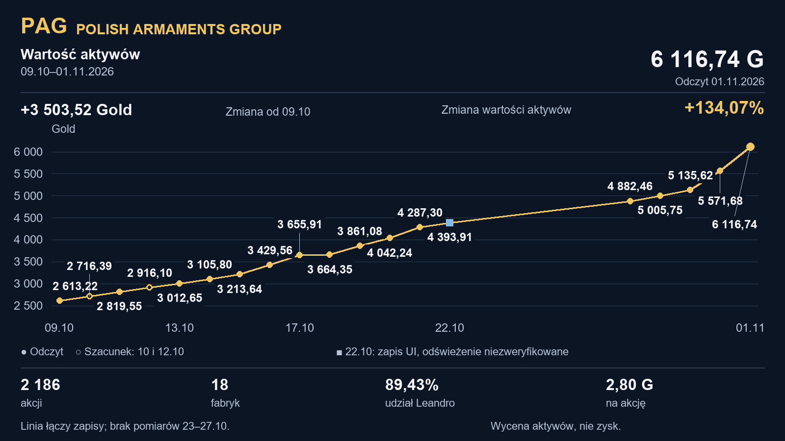

# PAG — Polish Armaments Group (Vexa)

[Wersja interaktywna — pobierz plik i otwórz w przeglądarce](pag-chart.html) · [Historia pomiarów](history.json) · [Spółka w Vexa](https://vexa.e-sim.org/stockCompany.html?id=45)

Ostatni zachowany odczyt: **1 listopada 2026, 20:48 czasu polskiego** — **6116,74 Gold**, 2186 akcji, 18 fabryk i 11 udziałowców. Leandro Daniels: 1955 akcji, czyli 89,43%. Wartość aktywów na akcję: 2,7981 Gold (w Vexa: 2,80 Gold). Od 31 października: +545,06 Gold (+9,78%); +97 akcji ogółem i +95 akcji Leandro. Raportu nie odświeżano podczas odczytu.

Historia zawiera 19 zapisów od 9 października do 1 listopada. Zmiana wartości od 9 października: +3 503,52 Gold (+134,07%); od 11 października: +3 297,19 Gold (+116,94%). Wycena obejmuje przepływy kapitału i zmiany cen aktywów; nie jest zyskiem ani stopą zwrotu akcjonariusza. Wartość aktywów na akcję nie jest ceną transakcyjną.

## Źródła i statusy

- 9–22 października: [oryginalny raport graficzny](https://github.com/piotrzdrenka-droid/pag-chart/blob/dabc5284a8e3a2c2b851749b9b2a80d6f93eb245/pag-chart.png), przekazany przez użytkownika 29 października. Oznaczenie „potwierdzone według raportu” zachowuje deklarację źródła; nie oznacza niezależnej weryfikacji.
- 10 i 12 października: szacunki brakujących dni z oryginalnego raportu, oznaczone pustymi kółkami. Nie są pomiarami.
- 22 października: zapis UI (4393,91 Gold; 1888 akcji; 9 udziałowców; 16 firm; 2,33 Gold na akcję według raportu), oznaczony kwadratem. Odświeżenie wyceny niezweryfikowane.
- 11 października: dane użytkownika z wcześniejszej rozmowy, zgodne z raportem.
- 28 października: wcześniejszy odczyt publicznej strony Vexa. Czas zapisu nie jest czasem aktualizacji wyceny aktywów.
- 29 października: odczyt publicznej strony Vexa; serwis potwierdził odświeżenie raportu.
- 30 października, 20:01 Europe/Warsaw: odczyt widocznej strony Vexa, bez wywołania odświeżenia raportu.
- 1 listopada, 20:48 Europe/Warsaw: odczyt publicznego HTML Vexa bez logowania przez HTTP GET; bez wywołania odświeżenia raportu.
- Dywidenda 200 Gold z 13 października według raportu jest osobnym zdarzeniem, nie została doliczona do wyceny.

Brakujące metryki są zapisane jako `null`. Nie interpolujemy brakujących dni jako pomiarów. Nie ma odczytów z 23–27 października.

## Aktualizacja i odtwarzanie

Źródłem danych jest `history.json`; dopisuj pomiary z datą, czasem odczytu, źródłem i statusem, nie usuwając wcześniejszych. Dla nowych pomiarów zapisz nieznane wartości jako `null`. Po zmianie uruchom `python build.py` (Python 3, biblioteka Pillow). Skrypt sprawdza unikalność i kolejność zapisów, odtwarza PNG i fragment interaktywny oraz aktualizuje dane w istniejącym eksporcie HTML. Wersja interaktywna wymaga dostępu do D3 z CDN jsDelivr.

Generowane pliki są zapisywane przez pliki tymczasowe i atomową podmianę. Przed publikacją sprawdź odczyt JSON, zgodność liczb i renderowanie wykresu. Zmiany PNG, historii i HTML publikuj razem w jednym commicie. Automatyczny pomiar w rozmowie jest ustawiony codziennie o 20:00 Europe/Warsaw; nie jest to harmonogram GitHub Actions.
